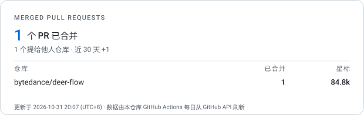

<div align="center">


# gouyu-hou

**AGENT DEVELOPER · BACKEND / FULLSTACK**

Agent开发 · 后端/全栈 · 2027届本科在读

关注 Agent 执行链路、工具调用和会话恢复，在 openclaw、deer-flow 等开源仓库提交 bug 修复与回归测试。

[GitHub](https://github.com/gouyu-hou) · [已提交的全部 PR](https://github.com/search?q=author%3Agouyu-hou+type%3Apr&type=issues) · [已合并的全部 PR](https://github.com/search?q=author%3Agouyu-hou+type%3Apr+is%3Amerged&type=issues)

</div>

---

## 已合并 Pull Requests



上面这张卡片由 [`scripts/generate-profile.mjs`](scripts/generate-profile.mjs) 每天自动生成，数据来源是 GitHub 的搜索接口 `type:pr author:gouyu-hou is:merged`，不依赖任何第三方渲染服务。

### 最近合并

<!-- MERGED-PRS:START -->
- [#7736 fix(console): tolerate malformed usage counters and pricing](https://github.com/bytedance/deer-flow/pull/7736) · bytedance/deer-flow · 2026-10-31

<!-- MERGED-PRS:END -->

<details>
<summary>这个数字是怎么算的</summary>

统计口径是 **Pull Request 被合并的数量**，不是 commit 数，也不是 Contributions 热力图：

- 数据来自 `GET /search/issues?q=type:pr author:<user> is:merged`，等价于浏览器里搜 `author:gouyu-hou type:pr is:merged`；
- 命令行同样可以随时复核：`gh api "search/issues?q=type:pr+author:gouyu-hou+is:merged" --jq '{total: .total_count}'`；
- 「近 30 天」按 PR 的 `merged_at` 计算，和 PR 什么时候开无关；
- 仓库星标数来自 `GET /repos/{owner}/{repo}`，卡片上只展示 PR 数最多的前 6 个仓库。

为什么不直接用 GitHub 自带的图：官方的 Contributions 热力图只按时间分布展示 commit，Insights 里的 Contributors 榜单是仓库视角而且有索引延迟，两者都不提供「这个人合并了多少 PR」这一维。

</details>

<details>
<summary>本地怎么跑</summary>

```bash
export GITHUB_TOKEN="$(gh auth token)"
node scripts/generate-profile.mjs

# 或者：网络受限时先用 gh 抓数据，再离线渲染
gh api "search/issues?q=type:pr+author:gouyu-hou+is:merged&per_page=100" > assets/raw.json
node scripts/generate-profile.mjs --data assets/raw.json
```

</details>
