<!-- REPO-LIST:START -->
<table>
<tr>
<td width="46"></td>
<td><b>仓库</b></td>
<td align="right" width="150"><b>已合并 PR</b></td>
<td align="right" width="96"><b>星标</b></td>
</tr>
<tr>
<td width="46" valign="middle"></td>
<td valign="middle"><a href="https://github.com/bytedance/deer-flow"><b>bytedance/deer-flow</b></a></td>
<td align="right" valign="middle" width="150"><b>1</b> 个已合并 PR</td>
<td align="right" valign="middle" width="96">★ 84.8k</td>
</tr>
</table>
<!-- REPO-LIST:END -->

